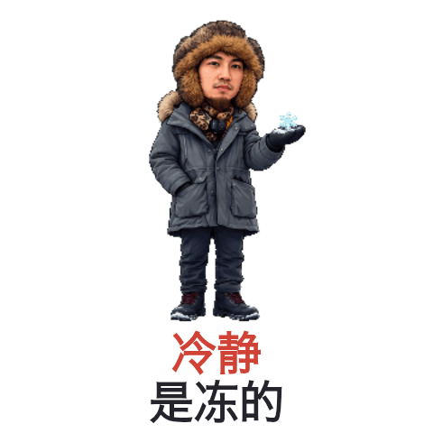

# 微信表情包工坊

**先挑喜欢的画风，再让你的表情包替你说话。**

上传照片，和 AI 聊聊你想要的感觉：**软萌可爱、接近真人、热血动漫、黑白暴漫、复古像素、毛绒玩偶、水彩水墨……** 你可以先让它生成几种画风小样，挑中喜欢的，再把日常、经历和口头禅做成一套会动的自己。

**不懂画风名字也没关系。** 说“更萌一点”“像我本人一点”“再离谱一点”，也能继续调整。

[看 12 种动态画风](#同一个我12-种画风都能动) · [先试画风](#先看小样选中了再做整套) · [安装使用](#安装) · [看看个人梗](#把经历变成只有你才有的梗) · [完整使用说明](docs/usage.md) · [下载技能 ZIP](https://github.com/MerlinStudio1828/create-wechat-stickers/raw/refs/heads/main/dist/create-wechat-stickers.zip)

## 同一个我，12 种画风，都能动

**可爱不止一种，搞笑也不只有一种画法。** 下面 12 款都是 @导演梅林君 本人形象的实际 GIF：保留眼镜、发型、胡须等辨识点，用不同画法演出不同情绪。

喜欢哪种，直接告诉 AI 编号或名字；也可以说“再萌一点”“再离谱一点”。**点击动图可打开对应的 240px 透明 GIF。**

### 想要可爱？先看这三种

<table>
  <tr>
    <td align="center" width="33%"><strong>01 · 软萌 Q 版</strong><br><a href="examples/styles/soft-cute-hug-240.gif"></a><br>「抱抱充电」<br><sub>圆润二维、软乎乎的治愈感</sub></td>
    <td align="center" width="33%"><strong>02 · 潮玩 3D</strong><br><a href="examples/styles/toy-cpu-240.gif"></a><br>「CPU烧了」<br><sub>立体小人，也会脑内冒烟</sub></td>
    <td align="center" width="33%"><strong>03 · 毛绒玩偶</strong><br><a href="examples/styles/plush-cheer-240.gif"></a><br>「给你打气」<br><sub>像能抱在怀里的小玩偶</sub></td>
  </tr>
</table>

### 熟悉的自己，也能很有戏

<table>
  <tr>
    <td align="center" width="33%"><strong>04 · 偏写实大头</strong><br><a href="examples/styles/recognizable-director-240.gif"></a><br>「再来一条」<br><sub>保留熟悉的脸和神态</sub></td>
    <td align="center" width="33%"><strong>05 · 清线漫画</strong><br><a href="examples/styles/comic-one-more-take-240.gif"></a><br>「再来亿条」<br><sub>利落线条，导演的戏很多</sub></td>
    <td align="center" width="33%"><strong>06 · 日系热血动漫</strong><br><a href="examples/styles/anime-fired-up-240.gif"></a><br>「燃起来了」<br><sub>赛璐璐色块，情绪直接拉满</sub></td>
  </tr>
</table>

### 发进群聊，就要让人记住

<table>
  <tr>
    <td align="center" width="33%"><strong>07 · 黑白暴漫</strong><br><a href="examples/styles/monochrome-meme-240.gif"></a><br>「我裂开了」<br><sub>黑白粗线，夸张才有梗</sub></td>
    <td align="center" width="33%"><strong>08 · 复古像素</strong><br><a href="examples/styles/pixel-level-up-240.gif"></a><br>「又升级了」<br><sub>把自己变成游戏里的角色</sub></td>
    <td align="center" width="33%"><strong>09 · 剪纸拼贴</strong><br><a href="examples/styles/paper-cut-applause-240.gif"></a><br>「给你鼓掌」<br><sub>层层纸片，掌声也有质感</sub></td>
  </tr>
</table>

### 想要质感？换一种画法

<table>
  <tr>
    <td align="center" width="33%"><strong>10 · 水彩绘本</strong><br><a href="examples/styles/watercolor-thanks-240.gif"></a><br>「谢谢你呀」<br><sub>淡彩渗色，温柔地说谢谢</sub></td>
    <td align="center" width="33%"><strong>11 · 国风水墨</strong><br><a href="examples/styles/ink-calm-240.gif"></a><br>「问题不大」<br><sub>几笔浓淡墨，淡定有画面</sub></td>
    <td align="center" width="33%"><strong>12 · 手作黏土</strong><br><a href="examples/styles/clay-off-duty-240.gif"></a><br>「脑子下班了」<br><sub>手捏质感，累到软成一团</sub></td>
  </tr>
</table>

这是一份可继续扩展的画风菜单，不是只能套用的 12 个模板。**可以更萌、更像真人、更夸张，也可以把喜欢的画风和自己的生活梗组合起来。** 新用户上传自己的照片，就以自己的形象制作。

本次新增 8 款动态小样，与已有 4 款一起展示；所有动图都包含实际绘制的动作变化。[完整提示词与检查记录](examples/styles/production.json)随示例公开。

## 先看小样，选中了再做整套

1. **描述感觉**：上传照片，说想更萌、更像本人、更夸张，或者直接给画风参考。
2. **先看不同版本的自己**：让 AI 先做 3–6 种画风小样；也可以明确要求每种一张动态 GIF。
3. **选中并微调**：例如“选第 2 种，眼镜保留，头发蓬松一点，动作再夸张些”。
4. **扩展成整套**：确定角色画风后，再制作常用反应、个人梗和配套素材。

想试试看，可以直接复制：

```text
用我上传的照片先做 4 种画风小样：
软萌 Q 版、毛绒玩偶、黑白暴漫、复古像素。
每种都做一张“我来了”的透明动态 GIF，保留我的辨识特征。
先给我编号对比，等我选好喜欢的画风，再做整套。
```

不确定怎么选，也可以只说：

```text
我想做自己的表情包，但还不知道适合什么画风。
请按我的照片推荐几种差异明显的方向，先做小样给我挑。
```

已经有想法，就直接说“按这个画风做 12 张”，无需先做一轮试稿。你也可以要求“第 2 种的脸＋第 4 种的配色”，先看一张融合小样再继续。

## 把经历变成只有你才有的梗

好用的个人表情，会让朋友觉得：“这话确实像你会说的。”古装、动物合影、剪片、演唱会、旅行，都能成为聊天里的反应素材。

<table>
  <tr>
    <td align="center" width="33%"><br>抱大象的时候，也顺便抱住了大佬。</td>
    <td align="center" width="33%"><br>进度条走得很慢，催稿消息来得很快。</td>
    <td align="center" width="33%"><br>换上古装，甲方也得等朕一下。</td>
  </tr>
  <tr>
    <td align="center" width="33%"><br>YES 和 NO，我都能解释。</td>
    <td align="center" width="33%"><br>看起来情绪稳定，其实冻得动不了。</td>
    <td align="center" width="33%"><br>到现场就起飞，快乐不必太克制。</td>
  </tr>
</table>

**照片里的细节，接上聊天里的情绪，就是一个梗。**

| 照片提供了什么 | 怎么把它变成表情 | 什么时候发 |
| --- | --- | --- |
| 古装试穿、一本正经的姿势 | “朕的耐心余额不足”，先端着，再破防 | 等回复、等进度、被反复追问 |
| 和大象合影 | “抱紧大佬”，把体型反差变成动作 | 求带飞、表达佩服、谢谢帮忙 |
| 剪辑工作台和满屏时间线 | “正在导出别催”，忙到只剩一个微笑 | 回复催稿、解释暂时离线 |
| 演唱会现场与热烈的反应 | “人已到场，魂已起飞”，把开心放大成动作 | 现场打卡、分享兴奋、快乐上头 |

这些是作者本人已有照片衍生的创作示例。换成你的照片，就从你的服装、道具、动作和趣事重新选梗。

## 想要哪种味道，都可以直接说

画风可以用名字、感觉或参考图来描述；日系、黑白线稿、像素、复古漫画等方向也可以提出，让 AI 先做小样验证效果。支持静态梗图、透明动态 GIF，以及横幅、封面、头像等微信投稿配套素材。未指定画风且希望直接开做时，采用活泼大头 Q 版。

| 方向 | 适合怎么用 | 可以这样提要求 |
| --- | --- | --- |
| **写实／偏写实** | 想保留真人神态、熟人一眼认出 | “保留我的脸部细节，卡通比例不要太夸张。” |
| **活泼大头 Q 版** | 日常聊天、夸张反应、个人经历 | “保留我的眼镜和胡须，动作放开一点。” |
| **清线漫画** | 吐槽、反差梗、戏很多的表情 | “像上面的导演梗，线条利落，表情夸张。” |
| **潮玩 3D** | 可爱、震惊、无语、求抱抱 | “做成圆润的潮玩小人，别太写实。” |
| **手作黏土** | 躺平、委屈、崩溃、软萌吐槽 | “有黏土质感，累到瘫成一团。” |
| **日系动漫** | 热血加油、惊讶、燃起来 | “用赛璐璐画法，动作和表情像动画里的高光时刻。” |
| **毛绒玩偶** | 鼓励、撒娇、安慰 | “像能抱起来的绒毛娃娃，眼镜和胡子也用布料表现。” |
| **黑白暴漫** | 崩溃、无语、离谱反应 | “用简洁粗线，表情夸张，但一眼还能看出是我。” |
| **复古像素** | 升级、通关、收到、出发 | “把我画成像素游戏角色，保留眼镜和发型轮廓。” |
| **剪纸拼贴** | 夸夸、庆祝、有设计感的反应 | “用彩色纸片层叠出我的形象，能看见剪裁边缘。” |
| **水彩绘本** | 感谢、晚安、温柔回复 | “淡淡的水彩和手绘感，表情自然亲切。” |
| **国风水墨** | 淡定、悠闲、古风吐槽 | “用浓淡墨线和少量青绿点色，保留我的神态。” |
| **个人情境与换装** | 旅行、工作、古装、兴趣爱好 | “用我的古装照做职场嘴替，用旅行照做出发梗。” |

画风决定怎么画，照片决定主角是谁。脸型、眼镜、发型、胡须等辨识点会贯穿整套；不同台词配不同表情、手势和道具。

## 一句话开工，拿到一整套

- **帮你选梗**：约一半高频聊天反应，一半来自照片里的个人特点与经历。
- **帮你演出来**：动态表情绘制 6 或 8 个独立姿态，让眼神、嘴型、手势和道具真正发生变化。
- **帮你做成文件**：240px 透明 GIF、480px 展示版、透明静帧，统一中文排版。
- **帮你配齐门面**：专辑横幅、封面、聊天图标、角色头像、作者头像和主页横幅。
- **帮你整理好**：总览、离线动态图库、编号文案、提示词和检查记录，最后装进 ZIP。

默认 **30 张，约 15 张常用反应＋15 张个人梗，分成两套各 15 张**。也可以先做单张、8 张试用，或者指定一套主题。数量、画风和台词都可以改。

```text
用我上传的照片做 12 张表情。清线漫画风，保留我的眼镜和发型，
一半是“收到、无语、笑死、谢谢”这些常用反应，
一半根据我的旅行和古装照片选梗，台词短一点，动作夸张一点。
我要透明动态 GIF，配套素材一起打包。
```

## 安装

### 最简单：把这段话发给 Codex

```text
请使用 $skill-installer，从以下 GitHub 地址安装“微信表情包工坊”：
https://github.com/MerlinStudio1828/create-wechat-stickers/tree/main/skills/create-wechat-stickers

请保留 scripts、references、assets 和 agents，确认技能已被识别，
并检查图像生成能力、GIF 制作依赖和中文字体是否可用。
```

也可以下载上方的技能 ZIP，保存到电脑后，把文件交给 Codex 并说“请把这个压缩包安装为我的个人 skill”。

Codex 支持从 GitHub 仓库安装本地技能，并根据任务描述自动选用。若安装后没有出现，可重启 Codex。不同版本使用的个人技能目录可能不同，让当前环境的安装器处理即可；官方当前文档列出的用户目录为 `~/.agents/skills`。参见 [OpenAI 官方技能说明](https://learn.chatgpt.com/docs/build-skills)。

### 需要什么环境

| 能力 | 用途 |
| --- | --- |
| 可使用内置图像生成、图片查看和本地文件处理的 Codex 环境 | 根据照片绘制人物和关键姿态，并检查实际图片 |
| Node.js 20.9 或更新版本 | 运行 GIF 编码与打包脚本 |
| sharp、@napi-rs/canvas、jszip | 图片处理、中文排版、ZIP 打包 |
| 可用的中文字体 | 防止字幕变成方框；可通过 `STICKER_FONT` 指定字体 |

技能不附带图像生成服务。生成能力与可用额度由使用者当前的产品环境提供。默认流程调用内置生图工具；仅制作本地素材时无须登录微信。

## 开始使用

安装好后，上传几张能看清人物的照片。想先选画风，用上面的[小样请求](#先看小样选中了再做整套)；想直接开做，可以发送：

```text
做微信表情包。
```

如果希望控制第一批范围：

```text
用我上传的照片先做 8 张微信表情：收到、谢谢、笑死、晚安、
我来了、让我想想、打工中、先吃饭。活泼一点，透明动态 GIF，配套素材一起打包。
```

修改成品可以直接说：

```text
第 3 张“请看这一版”动作再夸张一点：掀盖时有期待感，
揭晓后得意地展示作品。保留眼镜和胡须，台词不要变。
```

不必描述网格、帧数或编码方式。技能会建立人物基准、保存提示词、生成动作、检查透明边缘，然后补齐配套图。单张、整套、情侣或亲友主题都可以从同一入口开始。更多请求示例与微信自用方法见 [使用说明](docs/usage.md)。

## 一张表情如何做出来

<details>
<summary>展开看：选梗 → 八个动作姿态 → 透明 GIF → 深浅底检查</summary>


以“时区续命”为例：照片确定人物特征，咖啡和困意形成聊天梗，再设计“疲倦 → 喝一口 → 清醒 → 兴奋跳起 → 坐回去”的动作。


原画不生成文字；中文在本地统一排版。编码后分别放在浅色和深色背景检查，确保独立 GIF 的底色是真的透明。


这里 8 个姿态通过不同停顿长度组成 40 帧、2 秒的动画。20 fps 是本工作流的时间基准，不代表每秒生成 20 张不同画，也不是微信官方规定的固定帧率。GIF 透明度为二值透明，不能保存 PNG 那样的半透明通道。

完整过程、我们如何从“有图”改进到“动作活泼且完整交付”，见 [案例文章](docs/case-study.md)。

</details>

## 拿到的文件

| 内容 | 用途 |
| --- | --- |
| 240px 透明 GIF | 聊天自用与普通表情主图 |
| 480px GIF、透明 PNG | 放大检查和静态备用 |
| 750×400 专辑横幅、240px 封面、50px 聊天图标 | 每套专辑的配套美术素材 |
| 240px 角色头像、640px 作者头像、主页横幅 | 不同页面用途，分别导出 |
| 120px 缩略图 | 额外提供的兼容素材 |
| overview.png、gallery.html | 静态总览、可离线查看的动态图库 |
| 文案、编号、提示词、检查记录和 ZIP | 便于整理、修改、分享与后续投稿 |

下面是更早一套本人作品的**独立横幅示例**，画风更写实，与首页精选动图不属于同批次：


普通表情专辑当前公开指南允许每套 8–24 张。素材规格记录于 [微信平台参考](skills/create-wechat-stickers/references/wechat-platform.md)，核验日期为 **2026-10-14**；实际制作会复核当时的公开说明。技能交付的是素材，不自动提交平台，也不承诺审核通过。

## 想运行或修改脚本

将仓库下载或克隆到本地，在仓库目录运行：

```sh
npm run setup
npm run check
```

如果环境已经提供这些依赖，可以直接使用现成运行环境。只安装了技能文件夹时，也可以进入该技能目录执行 `npm ci`。需要指定依赖目录或字体时，使用 `STICKER_NODE_MODULES` 和 `STICKER_FONT`，详见 [编码说明](skills/create-wechat-stickers/references/encoding.md)。

创建项目清单和动作原画后：

```sh
npm run encode -- --project /absolute/path/to/project
npm run package:stickers -- --project /absolute/path/to/project --allow-unreviewed
```

第二条命令产生检查包。由 Codex 实际查看成品并填写对应哈希的视觉检查记录后，再去掉 `--allow-unreviewed` 生成最终包。脚本不会把机器检查自动当成视觉通过，也不会生成缺失的原画。详见 [打包说明](skills/create-wechat-stickers/references/packaging.md)。

```text
skills/create-wechat-stickers/  可安装的完整技能
docs/                          中文使用说明与真实案例
examples/                      本人形象的精选演示素材
scripts/                       运行环境检查
dist/                          可直接分享的技能 ZIP
```

## 分享与反馈

给朋友发送 [这个仓库地址](https://github.com/MerlinStudio1828/create-wechat-stickers) 即可；他可以阅读首页、看动图、安装技能，再上传自己的照片。反馈问题时请描述操作、预期与实际结果；有个人照片的示例可以先只提供不含隐私的截图。

代码与流程文档使用 [MIT License](LICENSE)。`examples/` 和技能 `assets/` 中的人物图片是效果演示，不包含在 MIT 授权中；如需复用作者人物形象，请先联系作者。新用户应以自己的或已获授权的照片制作表情。素材来源和实际尺寸见 [示例来源记录](examples/provenance.json)。首页新增的多画风动态小样使用内置图像生成工具绘制独立动作，再本地排字和编码；完整提示词与检查记录见 [动态画风示例记录](examples/styles/production.json)。早先的静态画风稿仍保留在 `examples/showcase/`，其提示词见 [静态稿生成记录](examples/showcase/prompts.json)。

A Codex skill for turning your photos and everyday stories into expressive, personal stickers—in multiple visual styles, with animated GIFs and complete delivery assets.

本项目为个人创作工具，与微信、腾讯或 OpenAI 无官方隶属关系。
