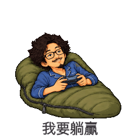
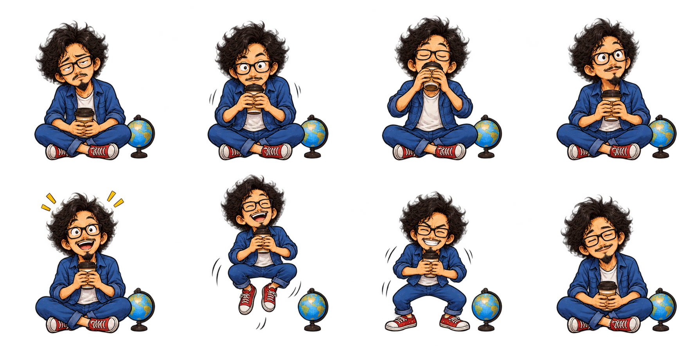
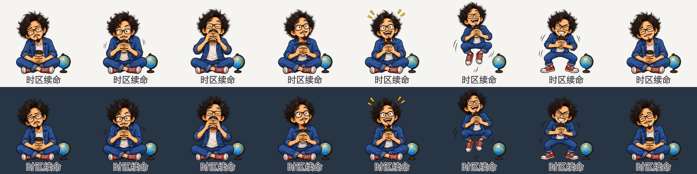

# 制作案例：把本人的日常做成动态表情

这项技能来自一次持续迭代的个人表情制作流程。案例使用作者本人的单人卡通形象；公开仓库只展示选定的成品和制作素材，不公开原始人物照片、私人聊天全文或他人肖像。

下面按制作步骤总结过程。除明确标注的原话外，叙述和示例提示词都是归纳整理，并非逐条聊天实录。示例作品来自技能整理之前的实际项目，用来说明创作效果；它们不表示整套旧项目已经用本仓库的新脚本重新生成了一遍。

| 时区续命 | 我要躺赢 | 请看这一版 |
|:---:|:---:|:---:|
|  |  |  |

上面三张均为 240×240 的实际 GIF 文件；若你的阅读器关闭了动图播放，可以点开文件查看。

## 现在也可以先选画风，再开始整套

同一个人的辨识特征，可以转成差异很大的画法。[首页现有 12 种动态画风](../README.md#同一个我12-种画风都能动)：在偏写实、清线漫画、潮玩 3D、手作黏土之外，又补做了软萌 Q 版、日系热血动漫、毛绒玩偶、黑白暴漫、复古像素、剪纸拼贴、水彩绘本和国风水墨。每款新小样都分别绘制独立动作；轮廓、材质、配色和表情表达一起变化，让人真正看出画法的区别。

现在的技能开场会说明可选方向。用户可以先说“用我的照片做几种画风小样，等我选好再继续”，看到编号对比后，再决定哪种脸部画法、比例、材质和情绪最像自己。想比较动作时可要求每种提供透明动态 GIF；只试画法时可先看静态小样。已确定画风就直接开做。

这是一种可选的开始方式。下面继续展示早期本人作品从选梗到完整交付的过程；它们与首页新增画风小样属于不同批次。新动图的[完整提示词与检查记录](../examples/styles/production.json)也已公开，便于了解如何实现不同画法。

## 1. 先确定“是谁”，再决定“画什么”

我们从生活照片中提取能让人物被认出的特征，例如眼镜、发型和胡须，再把比例调整成活泼的大头 Q 版。服装、道具和动作可以变化，关键人物特征应保持一致。

这里有两类参考：清晰脸照负责人物身份；日常或旅行场景负责提供服装、姿势和道具。技能内的参考插画只负责说明画风，不能让每个使用者都生成同一张脸。

例如，案例人物戴眼镜、留有尖形胡须。画咖啡、休息或创作场景时，都应能看出是同一个人，而不是为每个题材换一个通用卡通角色。

## 2. 把题材变成聊天里会用的反应

照片提供素材，表情需要有明确的聊天用途。不是把每张照片分别描一遍，而是把一个可识别的生活片段，转成短台词和夸张反应。

实际制作清单中的题材包括：

| 表情 | 画面设计 | 可以表达什么 |
|---|---|---|
| 时区续命 | 困倦地捧杯，喝咖啡后眼睛睁大、精神回来 | 还需要一杯咖啡才能继续 |
| 我要躺赢 | 躺在睡袋中拿着手柄，得意后又缩回枕头 | 想轻松获胜，也想休息 |
| 请看这一版 | 揭开盖子，展示制作内容，再等待回应 | 请对方看看当前版本、给出反馈 |

这些是案例作者选择的创作情境，不应被套到每位新用户身上。新照片里没有的工作、地点或经历，不能仅凭画风参考就当成那位用户的个人事实。

## 3. 动画要有实际动作

灵动重制阶段采用了每张 8 个独立绘制姿态。以“时区续命”为例，其动作顺序是：

1. 困倦地捧着咖啡。
2. 双手举杯，准备喝一口。
3. 闭眼喝咖啡。
4. 放低杯子，开始回神。
5. 眼睛睁大，精神起来。
6. 兴奋地弹起，杯子仍由双手握住。
7. 落下并露出笑容。
8. 恢复到接近开头的状态。

眼神、嘴型、身体重心和杯子位置都有变化。节奏通过快动作和停顿来表现，而不是只把一张静态人物图整体放大、缩小或左右摇晃。

原项目这一张的检查记录为 8 个实绘姿态、40 个播放帧、每帧 50 毫秒，总时长 2 秒。40 个播放帧不等于画了 40 张不同图片；其中一些姿态会保持多个播放帧，用来形成停顿。这是作品的动画设计，不是微信平台强制的帧率要求。

下面是这一张实际使用的 4×2 动作原画。排列顺序为从左到右、先上后下；每格是一种实绘姿态：



## 4. 保留透明背景，并把中文排清楚

动作原画生成时不写文字，中文在本地排版。这样修改一句台词时，不需要连人物一起重新生成，也能减少生成文字的错字和变形。

原画优先使用真正的透明通道。随后按动作格切分、统一主体位置、排列姿态并导出 GIF。人物四周要留足空间，尤其是跳起的头发、伸出的手指和较大的道具；如果肢体在原画中已经被切断，应重绘受影响的动作。

GIF 的透明像素只有“透明”和“不透明”，因此检查时要同时看浅底和深底，留意白边、杂点、断指、跨格残片和明显跳位。PNG 原画则可以保留半透明边缘。



上图是检查用预览，底色帮助观察轮廓，并未烘焙到单张透明 GIF 里。

## 5. 成品不只有聊天 GIF

个人聊天优先使用独立的 240px GIF；展示时可以使用 480px 版本，挑选时看总览和动态预览页。如果准备专辑投稿，还需要为人物设计配套素材。

这次流程被整理成技能时，把横幅、封面、聊天图标、角色头像和作者头像都纳入默认交付。不同用途分别导出；例如小尺寸聊天图标需要保持头部清晰，而横幅需要完整的横向主题画面。多套专辑应有不同的封面和图标。

下面的横幅来自作者本人更早的另一套既有专辑，画法更写实；封面和聊天图标则来自上方的灵动重制版。它们用来说明不同文件的用途，**不能把这几张配图当作同一批次生成的整套作品**：


| 240px 专辑封面 | 50px 聊天图标 |
|:---:|:---:|
|  |  |

此处没有展示 640px 作者头像样例；完整技能仍将作者头像作为单独素材制作和交付，不能用这张 240px 封面改名替代。

这些素材准备完，并不代表已经向微信投稿或审核通过。尺寸、数量与体积目标见 [微信规格参考](../skills/create-wechat-stickers/references/wechat-platform.md)，各文件用途见 [使用说明](usage.md)。

## 6. 把反复讨论变成下次能直接用的默认值

作者提出的核心目标是：

> 用户不需要过多描述，只需要上传图片即可。

因此技能保留了“做表情”“做微信表情包”这样的自然触发词，并把读图、人物一致性、常用反应、照片选梗、实际动作、透明检查和完整打包放进同一流程。

直接制作整套时默认 30 张、分两套；小样模式先交付小样，等选定后再扩展。这是为了下次使用而确定的默认方案，不代表本页展示的灵动重制案例也恰好有 30 张。用户指定单张、8 张或其他数量时，按实际请求处理。

后续修改也可以像普通聊天一样表达：

```text
第 1 张的困倦到精神这个变化更夸张一点，保留眼镜和胡须。
```

```text
这张换成“马上开工”，其他人物和动作不变，更新完整包。
```

技能的价值是让这些改动能落到具体原画、字幕、导出文件和检查记录上，减少每次重新解释制作方法的工作。

## 本页依据

- 用户关于透明 GIF、完整投稿配套和自然触发方式的明确要求；上面的引文为用户原话。
- 既有“灵动重制版”的实际题材清单、动作说明与逐张导出记录，包含“时区续命”的 8 姿态、40 帧和 2 秒记录。
- 当前 [技能正文](../skills/create-wechat-stickers/SKILL.md)、[创作方法](../skills/create-wechat-stickers/references/creative-workflow.md)、[编码说明](../skills/create-wechat-stickers/references/encoding.md) 和 [打包说明](../skills/create-wechat-stickers/references/packaging.md)。

这些依据支持本文对已有流程和当前默认值的说明，不构成对每种设备、每次图像生成结果或平台审核结果的保证。

[开始使用](usage.md) · [回到仓库首页](../README.md)
